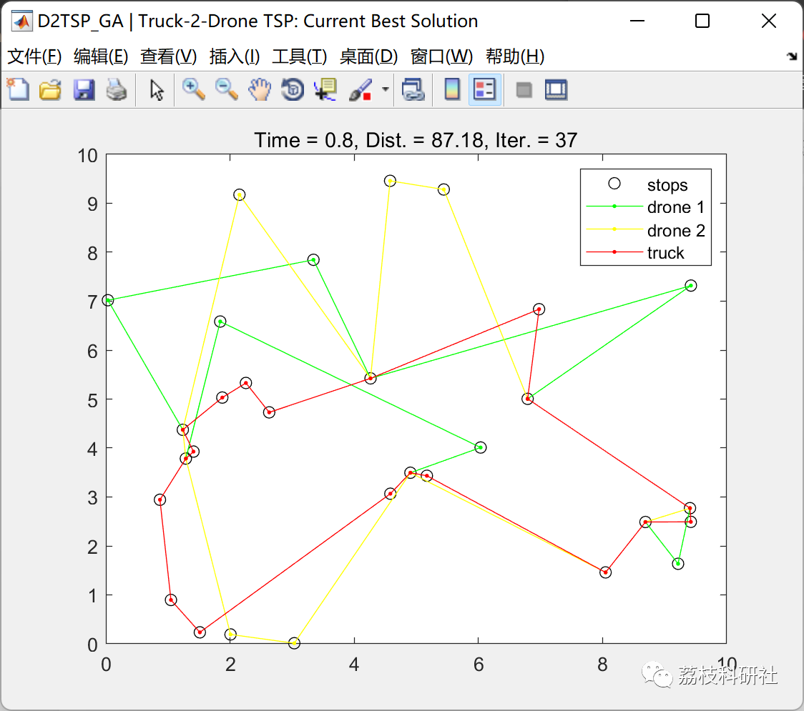
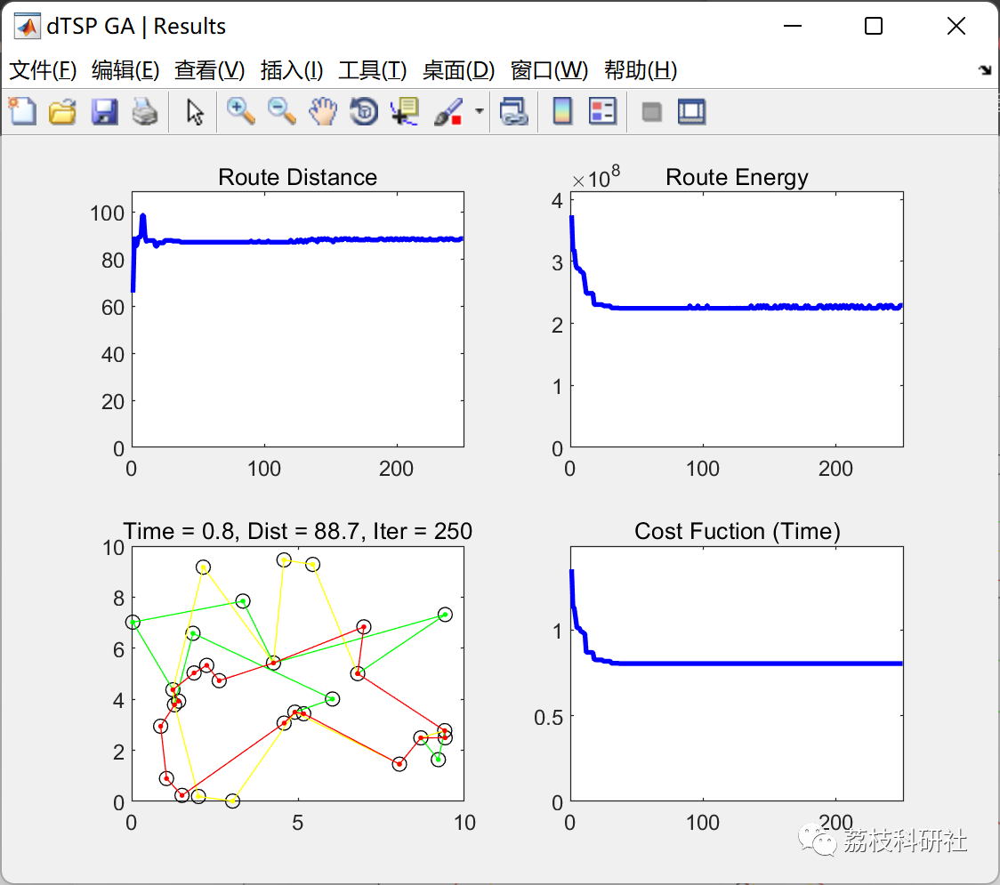
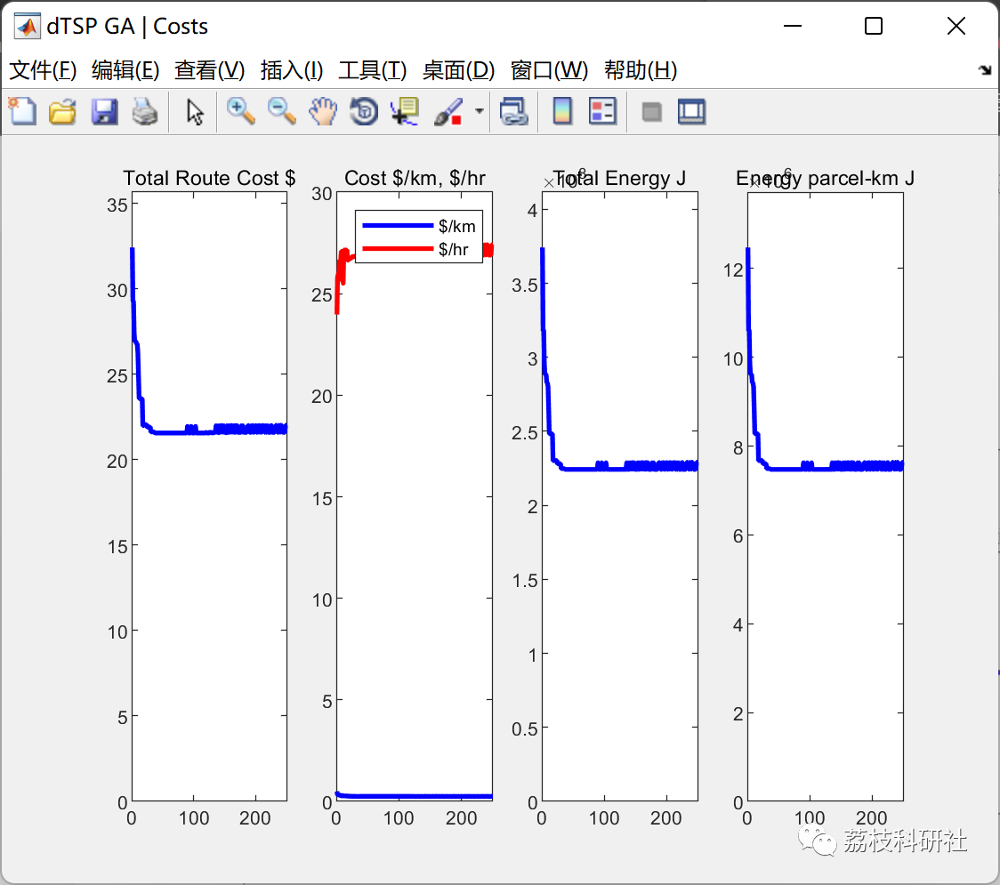

# Truck and two UAV Traveling Salesman Problem (D2TSP) based on improved genetic algorithm (Matlab code implementation)

🎉🎉🎉🎉 Welcome to your arrival! 😊😊😊
📝 Bedside inscription: I will definitely thank the hardworking self of now for the future!
Table of Contents
🌈1 Overview
🌟2 Running Results
⛳️3 References
💥4 MATLAB Code Implementation
🎁 Special Section Link:
🌈🌈🌈 Path Planning, Neural Network Prediction, Electrical Code, Intelligent Algorithms and Their Applications, Optimization Scheduling, Image Processing, Workshop Scheduling, Signal Processing, Romantic Her, Mathematical Modeling 🌟🌟🌟
🌈1 Overview
This article aims to solve the problem of truck and two drone travel salesman problems, represented as a series team, with drones providing last-mile efforts. The problem is solved using genetic algorithms (route mutation) to address it. This problem can solve the D2TSP of 100 cities randomly generated coordinates. The solution is based on minimizing time rather than distance. The shortest time calculation is based on the longest duration during which the truck or drone delivers. The operation is represented as a node or stop point where a drone (or both) launches, sends delivery, then recovers at a meeting location. Each drone is limited by its range and capacity. Therefore, the range and number of stops during the operation are limited by the constraints of the drone.
🌟2 Running Results
⛳️3 References
[1] Huang Shuzhao, Tian Junwei, Qiao Lu, Wang Qin, Su Yu. Improved Genetic Algorithm for Drone Path Planning [J. Computer Application, 2021, 41(02):390-397.
💥4 MATLAB Code Implementation
Click the article's lower left corner to read more.

## Images

<!-- PAYMENT_BLOCK -->

## Get this dataset

- Payment link (Stripe): [Buy now](https://buy.stripe.com/3cs8yP7sY87d0vu9AB)
- Payment QR code: 

<!-- /PAYMENT_BLOCK -->
